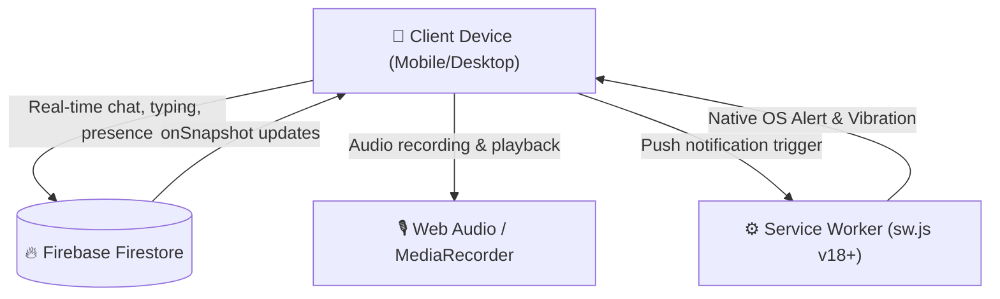
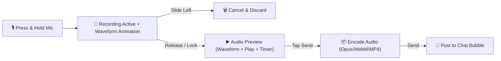
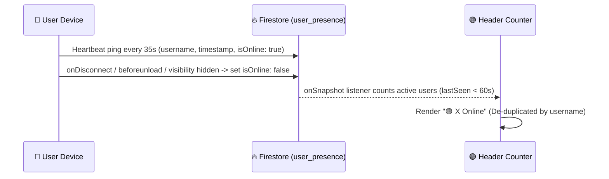
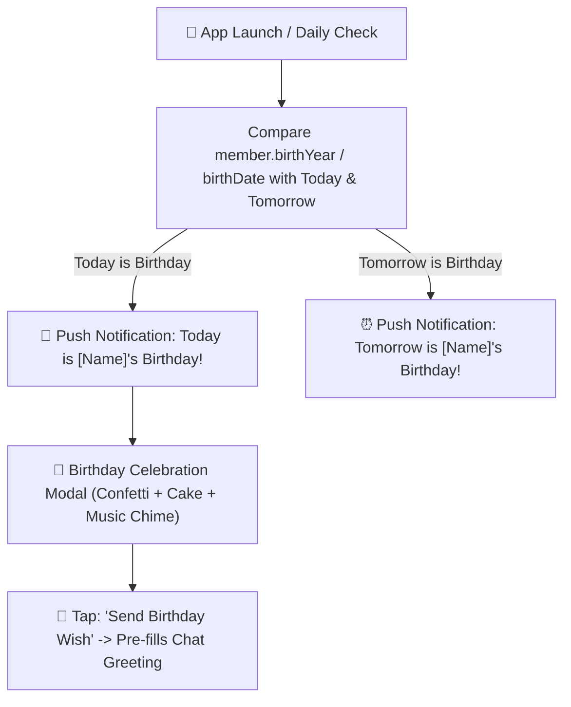
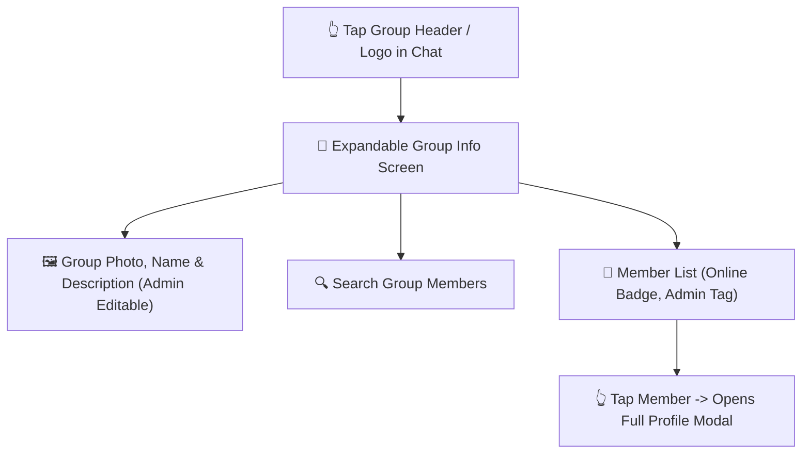
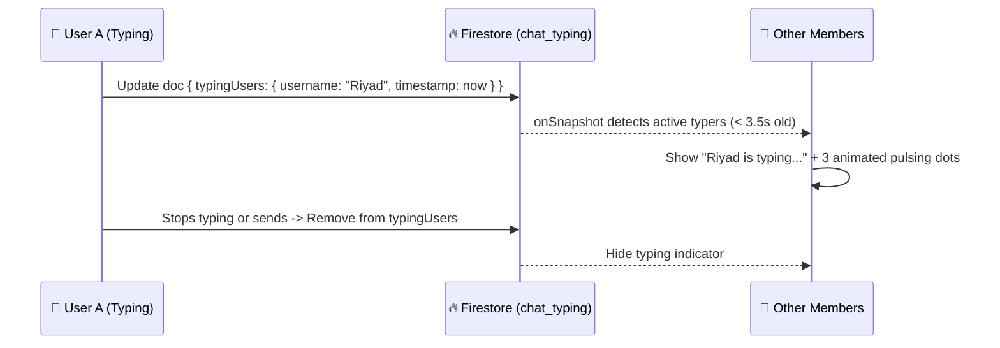
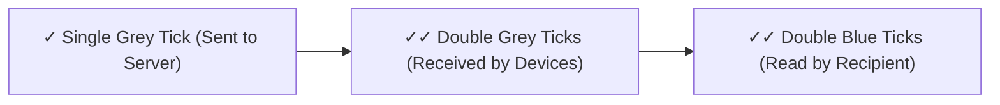
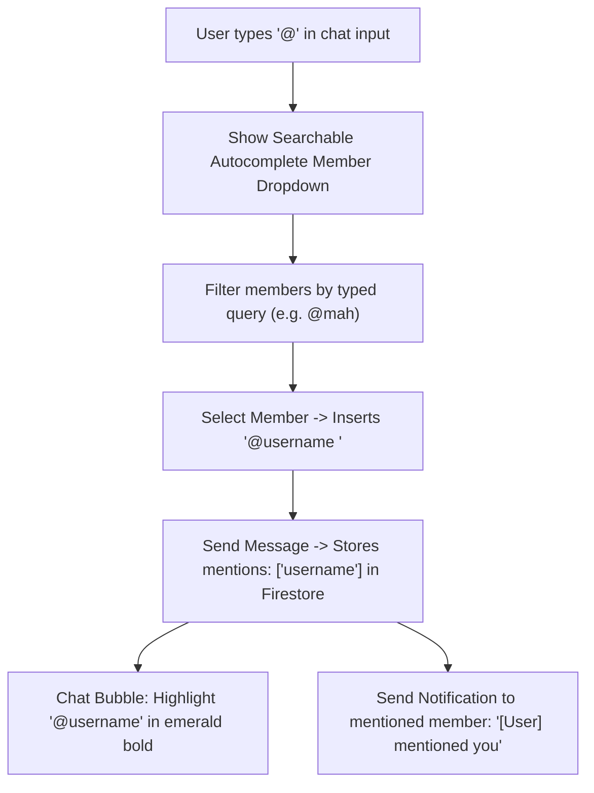
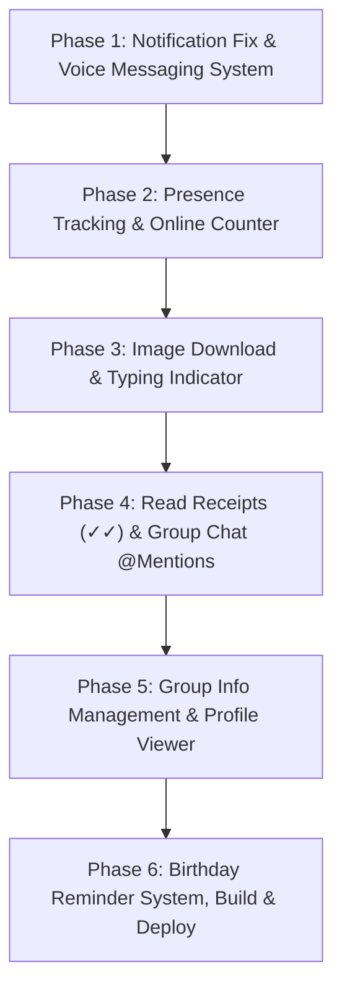

# 📋 Bongsho Brikkho — Comprehensive Implementation Plan
## Complete Modernization: Voice Messaging, Real-time Presence, Group Management, Birthday System, @Mentions & Mobile Push Fix

---

## 🎯 Executive Overview & Architecture

This plan establishes the architecture and execution strategy for 10 major feature suites in the **Bongsho Brikkho (বংশবৃক্ষ)** Family Tree web application.

Because the application is exported as a static Next.js PWA and hosted on **GitHub Pages** (`https://mahmud1947.github.io/bongsho-brikkho/`), all dynamic and real-time capabilities leverage:
1. **Firebase Firestore** for real-time synchronization (`onSnapshot`), presence heartbeats, typing indicators, and message states.
2. **Modern Web APIs**: `MediaRecorder API`, `Web Audio API`, `navigator.vibrate`, `Canvas API` (waveform rendering), and `ServiceWorkerRegistration.showNotification`.
3. **Optimized Local Caching (`localStorage`)** for offline resilience, unread tracking, and media preservation.



---

## 🛠️ Feature Breakdown & Technical Specifications

---

### Module 1: Voice Messaging System (ভয়েস মেসেজিং ফিচার)



#### 1. Microphone Button & Recording Controls
* **UI Placement:** Integrated directly into the chat bottom bar beside the text input and photo attach button.
* **Dual Recording Modes:**
  * **Hold-to-Record:** Press and hold the mic button to start recording immediately. Releasing sends the voice message.
  * **Slide-to-Cancel:** Sliding finger to the left (`< -50px`) cancels and discards the recording with red trash animation and haptic vibration.
  * **Lock / Tap Mode:** Sliding finger upwards locks recording mode, allowing hands-free recording with dedicated Stop, Preview, and Send buttons.
* **Recording Timer & Waveform:**
  * Real-time timer (`0:01`, `0:02`, ...) with pulsing red recording indicator.
  * Real-time live audio visualizer via `AudioContext.createAnalyser()` rendering animated frequency waveform bars on an HTML5 Canvas or CSS bar graph.
* **Microphone Permissions:**
  * Checks `navigator.mediaDevices.getUserMedia({ audio: true })`.
  * If permission is blocked or denied, displays an intuitive Bengali & English prompt explaining how to allow microphone access in site settings.

#### 2. Audio Storage & Compression
* Record using `MediaRecorder` with `audio/webm;codecs=opus` (Android/Chrome/Firefox/Desktop) and `audio/mp4` / `audio/aac` fallback (iOS Safari).
* Encode audio into ultra-compact chunks (32kbps to 48kbps Opus), converting to Base64 data URL stored directly inside Firestore message payload (`audioUrl`), or Firebase Storage object with Base64 fallback.
* A 15-second voice note is only ~45–60 KB, enabling instantaneous real-time transmission without separate media server roundtrips.

#### 3. Custom Chat Voice Player Component
* Integrated inside the message bubble:
  * Circular Play / Pause button with loading state.
  * Interactive scrubbable waveform/progress bar showing current playback position vs. total duration (e.g. `▶ 0:14 / 0:38`).
  * **Speed Controller:** One-tap toggle button cycling between **`1x` ➔ `1.5x` ➔ `2x`** playback rate with real-time rate adjustment via `audioElement.playbackRate`.
  * Distinct styling for sent vs. received voice notes (emerald/gold gradient for sender, clean white/stone for receiver).

---

### Module 2: Real-time Online Members Counter & Presence Tracking



#### 1. Presence Architecture
* **Collection:** `user_presence` in Firestore.
  ```typescript
  interface UserPresence {
    username: string;
    displayName: string;
    photoUrl?: string;
    lastSeen: string; // ISO Timestamp
    isOnline: boolean;
    clientPlatform: "mobile" | "desktop";
  }
  ```
* **Heartbeat Mechanism:**
  * While the tab is active/visible, sends a lightweight heartbeat document update every 35 seconds.
  * Listens to `document.addEventListener("visibilitychange")` and `window.addEventListener("beforeunload")`:
    * When tab goes to background or user closes app, immediately updates `isOnline: false` and `lastSeen: new Date().toISOString()`.
* **Multi-Device De-duplication:**
  * Keyed strictly by `username` in Firestore (`doc(db, "user_presence", username)`). If a user opens the app on both their phone and laptop, they are counted as **1** active family member.
* **Header Display:**
  * Shows right beside the family title/logo in the navigation and chat header:
    * `🟢 12 Online` (English) or `🟢 ১২ জন অনলাইন` (বাংলা).
* **Online Members Modal / Drawer:**
  * Tapping on the `🟢 X Online` pill opens a slide-over modal displaying the full list of currently online family members with their photo, full name, branch badge, and "Active Now" indicator.

---

### Module 3: Chat Image Download & Gallery Storage

#### 1. Download Buttons & Fullscreen Lightbox
* In both the inline message bubble and the fullscreen image Lightbox:
  * Adds an easily accessible **`Download` (ডাউনলোড)** action button with icon.
* **Saving to Gallery:**
  * Fetches the image Blob (`fetch(imageUrl).then(res => res.blob())`).
  * Generates an object URL and triggers native browser file download:
    `<a href={blobUrl} download={`bongsho_family_${messageId}.jpg`}>`.
  * On mobile devices supporting `navigator.share` with files, offers a 1-tap "Save to Photos / Share" menu.
* **Progress & Toast Confirmation:**
  * Shows a subtle circular progress spinner during download.
  * Displays a toast: `"ছবি সফলভাবে ডিভাইসে সংরক্ষিত হয়েছে! (Image saved successfully)"`.
  * Failure handling: If network drops during fetch, provides a "পুনরায় চেষ্টা করুন (Retry)" button.

---

### Module 4: Birthday Reminder, Notification & Celebration System



#### 1. Birthday Tracking Engine
* Automatically reads member dates from `members` collection:
  * Calculates current age, upcoming birthday countdown (days remaining), and exact birth date.
* **Local Date Precision:**
  * Uses the user device's local timezone (`Intl.DateTimeFormat().resolvedOptions().timeZone`) to evaluate birthdays accurately.
* **Deduplication:**
  * Stores notification record in `localStorage` (`bongsho_bday_notified_${year}_${memberId}_${type}`) so reminders fire only once per member per year.

#### 2. Festive Celebration Interface & Animations
* **Celebration Banner & Modal:**
  * When opening the app on a family member's birthday:
    * Festive celebration screen with celebratory animation (confetti bursts, floating balloons).
    * Shows photo, full name, age milestone (e.g. "২৫তম জন্মদিন"), and family branch.
    * **"Send Birthday Wish" (শুভেচ্ছা পাঠান) button:** Tapping navigates to `/chat` with input pre-filled with festive text:
      `"শুভ জন্মদিন [Name]! আল্লাহ আপনার জীবনে বরকত ও সুস্বাস্থ্য দান করুন 🎂🎉"`
* **Dedicated "Upcoming Birthdays" Section:**
  * Placed inside Member Directory and Profile/Heritage tab:
    * Chronologically sorted list of the next 10 family birthdays.
    * Shows days remaining (e.g. "আজকে!", "আগামীকাল", "৩ দিন পর").

---

### Module 5: Group Info & Member Management Screen



#### 1. Header & Group Profile (Admin Editable)
* Accessible by tapping the group header avatar/name in `/chat`.
* **Expandable Header:**
  * Displays large group logo/photo, group name ("বংশবৃক্ষ চ্যাট"), creation date, and description.
  * Smooth accordion slide-down animation on mobile.
  * **Admin Customization:**
    * Authorized admin sees an edit pencil icon (`✏️`).
    * Admins can change group name, description, and upload a new group avatar from phone camera or gallery.
    * Real-time sync via Firestore `group_settings/general` document.

#### 2. Group Member Directory & Online Presence
* Searchable list of all participating family members.
* Shows:
  * Profile picture (or initials avatar).
  * Bengali & English names, `@username`.
  * Online status badge (`🟢 Online` or `⚪ Last seen X ago`).
  * `Admin` badge (হলুদ রঙা অ্যাডমিন ব্যাজ) for administrators.
* **Member Profile Viewing:**
  * Tapping any member opens their comprehensive Profile Modal showing photo, full name, birth year, relation to lineage, parents, location, blood group, profession, bio, and phone/WhatsApp (if marked public).

---

### Module 6: Real-time Typing Indicator (কে টাইপ করছে...)



#### 1. Real-time Typing Synchronization
* **Document:** `chat_typing/active` in Firestore.
  ```typescript
  interface TypingState {
    [username: string]: {
      displayName: string;
      updatedAt: number; // Date.now()
    }
  }
  ```
* **Debounced Typing Trigger:**
  * When user types in `<textarea>`, broadcasts presence with a 2.5-second debounce.
  * If no keystroke for 3 seconds or message is submitted, deletes user's typing key.
* **Animated UI:**
  * Located above the bottom input bar:
    * `"রিয়াদ লিখছেন..."` with three jumping emerald dots animation.
    * If multiple: `"রিয়াদ, মাহমুদ লিখছেন..."`.

---

### Module 7: WhatsApp-style Message Delivery & Read Receipts



#### 1. Ticket States
* **`✓` (Single Grey Tick):** Successfully written to Firestore database.
* **`✓✓` (Double Grey Ticks):** Delivered to at least one active recipient device via Firestore snapshot listener.
* **`✓✓` (Double Blue Ticks):** Read by other family members (timestamped in `message.readBy`).
* **Group Info Sheet:**
  * In Long-Press / Action Menu on a message, tapping **"Message Info" (বার্তা তথ্য)** opens a modal showing:
    * Delivery timestamp.
    * Full list of who has read the message and at what time (`readBy`).

---

### Module 8: Complete User Profile Viewing from Chat

* **Clickable Avatars & Names:**
  * In every message bubble, clicking the sender's avatar or username `@username` immediately opens their rich profile modal.
* **Profile Information Displayed:**
  * Profile photo with zoom option.
  * Bengali name & English name.
  * Family relationship & generation (G1, G2, G3, G4...).
  * Parents (পিতা ও মাতা with auto-gender detection).
  * Date of birth / age, blood group.
  * Profession, education, address / city.
  * Contact info (Phone, WhatsApp, Social links) if shared.
  * Bio / personal intro.
* **Privacy Controls:**
  * Sensitive contact fields (phone, WhatsApp) are only displayed if the member has opted to share them.

---

### Module 9: Group Chat @Mention System



#### 1. Autocomplete Popup
* When `@` is typed in the chat text input, an autocomplete dropdown pops up immediately above the input bar.
* Displays suggestion cards: Photo, Full Name, `@username`.
* As user types after `@` (e.g. `@riy`), filters suggestions live.
* Tapping a suggestion inserts `@username ` and places cursor right after it.

#### 2. Chat Bubble Rendering & Profile Navigation
* When rendering message text in chat bubbles, regex parses `@([a-zA-Z0-9_.-]+)`:
  * Renders mentions in bold emerald font with a subtle highlight pill.
  * Tapping a highlighted `@username` opens that user's full profile card.

#### 3. Mention Notifications
* When a message containing `mentions` is saved to Firestore:
  * If `currentUsername` matches one of the mentioned usernames, and the user is not currently active on `/chat`:
    * Fires a high-priority browser notification: `"বংশবৃক্ষ চ্যাট: [Name] আপনাকে মেনশন করেছেন"` (body: message text preview).
    * Clicking navigates directly to `/chat` and auto-scrolls to the specific message.
  * Avoids notifying sender if they mention themselves.

---

### Module 10: Critical Mobile Notification Fix (মোবাইল নোটিফিকেশন সমস্যা সমাধান)

#### 1. Root Causes on Android & iOS
| Problem | Root Cause | Permanent Solution |
| :--- | :--- | :--- |
| **Android Chrome Error** | Calling `new Notification()` directly in page context throws `TypeError: Illegal constructor`. | Always use `(await navigator.serviceWorker.ready).showNotification(title, options)`. |
| **Relative Icon Failure** | Relative icon URLs (e.g. `/icons/icon.png`) fail resolution in background Service Workers on mobile. | Construct full absolute URL using `window.location.origin + basePath + '/icons/...'`. |
| **Silent Audio on Mobile** | Mobile browsers suspend `AudioContext` until an explicit user tap/gesture occurs. | Attach a global one-time touch listener on `window` to call `audioCtx.resume()`. |
| **iOS PWA Requirement** | iOS Safari (16.4+) requires web app to be added to Home Screen for Web Push. | Add friendly iOS PWA prompt explaining how to "Add to Home Screen" to receive notifications. |
| **PWA Service Worker Registration** | Service Worker was caching old versions without updating clients. | Implement `skipWaiting()` and `clients.claim()` with cache version bump to `v18`. |

---

## 🗄️ Database & Schema Extensions

```typescript
// Extended FamilyChatMessage
export interface FamilyChatMessage {
  id: string;
  text: string;
  imageUrl?: string;
  audioUrl?: string;          // NEW: Base64 data URI or Storage URL
  audioDuration?: number;     // NEW: Duration in seconds (e.g. 14.5)
  authorUsername: string;
  authorName: string;
  authorNameBn?: string;
  authorNameEn?: string;
  authorCountry?: string;
  authorPhotoUrl?: string;
  createdAt: string;
  editedAt?: string;
  isPinned?: boolean;
  replyTo?: {
    id: string;
    authorName: string;
    text: string;
  };
  reactions?: Record<string, string[]>;
  mentions?: string[];        // NEW: Array of usernames mentioned in this message
  status?: "sent" | "delivered" | "read"; // NEW: Delivery receipt status
  readBy?: Record<string, string>;        // NEW: { [username]: timestamp }
  deliveredTo?: Record<string, string>;   // NEW: { [username]: timestamp }
}

// User Presence (Collection: user_presence)
export interface UserPresence {
  username: string;
  displayName: string;
  photoUrl?: string;
  lastSeen: string;
  isOnline: boolean;
  platform: "mobile" | "desktop";
}

// Group Settings (Doc: group_settings/general)
export interface GroupSettings {
  groupNameBn: string;
  groupNameEn: string;
  descriptionBn: string;
  descriptionEn: string;
  logoUrl?: string;
  updatedAt: string;
  updatedBy: string;
}

// Typing State (Doc: chat_typing/active)
export interface TypingState {
  users: Record<string, { displayName: string; timestamp: number }>;
}
```

---

## 📅 Phased Execution Roadmap



### Phase 1: Mobile Notification Engine Overhaul & Voice Messaging
1. Fix `src/lib/notificationUtils.ts` to use Service Worker `showNotification` with absolute URLs, and add mobile audio context unlocker.
2. Implement `VoiceRecorder.tsx` with MediaRecorder, live waveform visualizer, hold-to-record, slide-to-cancel, lock mode, and audio preview.
3. Build `VoiceMessageBubble.tsx` with Play/Pause, scrubber progress, and `1x / 1.5x / 2x` speed toggles.
4. Update `FamilyChatMessage` type and `FamilyContext.tsx` to handle `audioUrl` and `audioDuration`.

### Phase 2: Real-time Online Counter & Presence Tracking
1. Implement presence heartbeat in `FamilyContext.tsx` syncing to Firestore `user_presence`.
2. Handle multi-device de-duplication and disconnect listeners (`visibilitychange`, `beforeunload`).
3. Add `🟢 X Online` pill beside the group logo in chat header and navbar.
4. Build `OnlineMembersDrawer.tsx` to display active members list.

### Phase 3: Chat Image Download & Real-time Typing Indicator
1. Add high-resolution image Download button with progress state in message bubbles and Lightbox.
2. Implement Firestore-backed `chat_typing` broadcast with debounced typing animation (`Riyad is typing...`).

### Phase 4: Delivery Receipts & @Mention System
1. Implement WhatsApp-style ticks (`✓`, `✓✓`, blue `✓✓`) and message read tracking (`readBy`).
2. Add `@` mention trigger in chat input with autocomplete popup and member search.
3. Highlight `@username` in bubbles and send push alerts to mentioned members.

### Phase 5: Group Info & Member Management Screen
1. Build `GroupInfoModal.tsx` accessible by tapping group header avatar/name.
2. Support admin editing of group logo, name, and description with real-time sync.
3. Show categorized group member list with admin badges and online status.
4. Enable full profile modal viewing by tapping any member's avatar or name.

### Phase 6: Birthday Reminder & Celebration System
1. Build birthday calculation and reminder hook in `FamilyContext.tsx`.
2. Implement birthday push notification engine (day before + birthday morning).
3. Create festive Birthday Celebration Modal with confetti, cake, and "Send Birthday Wish" button.
4. Add "Upcoming Birthdays" section in Directory and Profile pages.
5. Run full TypeScript build (`npx tsc --noEmit`), execute production static export (`npm run build`), and push commit to GitHub repository (`origin main`).

---

## 🔒 Verification & Quality Checklist

* [ ] **Mobile Touch Test:** Audio recording holds cleanly without triggering browser text selection or scrolling.
* [ ] **Audio Speed Test:** Voice notes switch seamlessly between 1x, 1.5x, and 2x without pitch distortion.
* [ ] **Android Notification Test:** Verified that `ServiceWorkerRegistration.showNotification()` delivers alerts on Android Chrome and PWA.
* [ ] **Presence Accuracy:** Verified that closing a browser tab drops the user from the online count within 45 seconds.
* [ ] **Offline Resilience:** All existing chat and tree viewing features remain functional when offline.
* [ ] **Build Integrity:** `npm run build` succeeds with static HTML export for all routes without errors.

